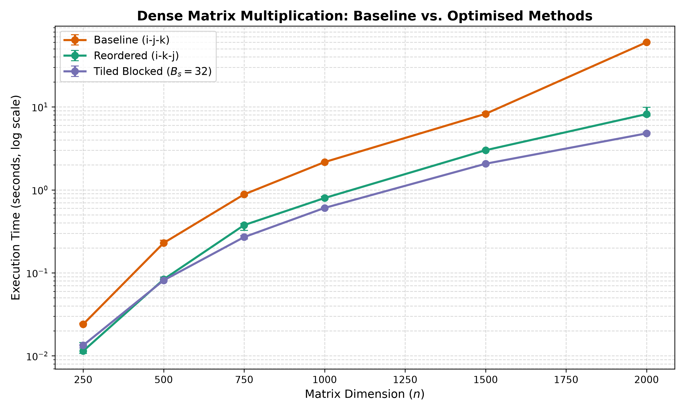
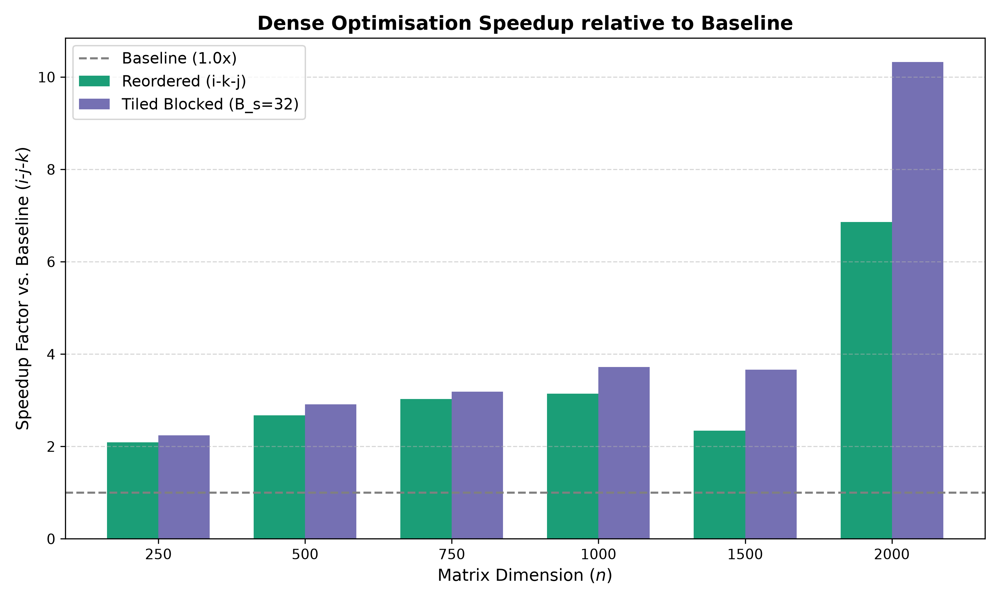
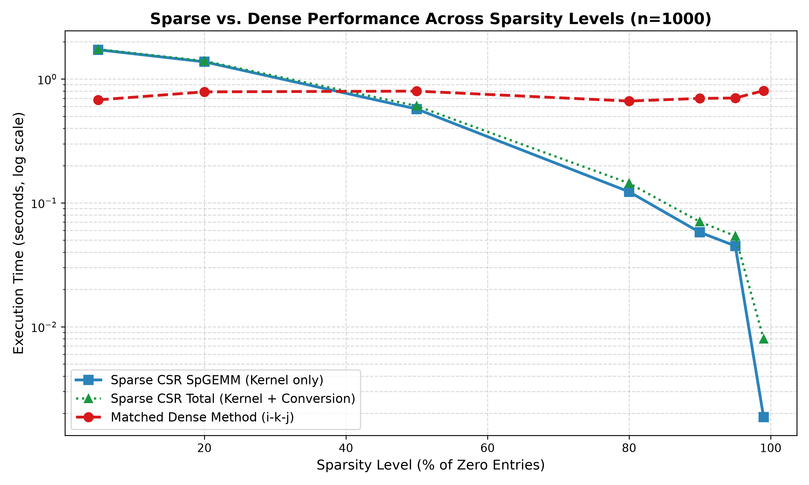
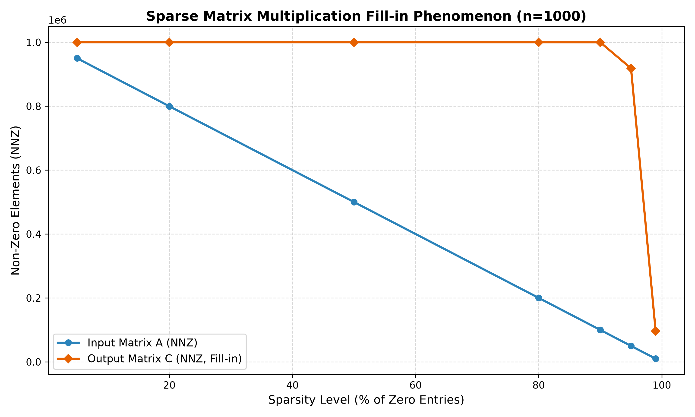

# Performance Study of Dense Matrix Multiplication Optimisations and Sparse CSR Representations

**Author:** Abel Castro Villar  
**Course:** Big Data (2026-2027)  
**Assignment:** Assignment 2  
**Date:** October 2026  

---

## Abstract
This study compares three sequential dense matrix multiplication implementations and a custom CSR sparse multiplication across a range of matrix dimensions and declared sparsity levels. In the physical benchmark measurements on an Intel Core i5-1335U, loop interchange (`i-k-j`) and cache blocking ($B_s = 32$) substantially outperform the canonical $i$-$j$-$k$ baseline, achieving maximum observed speedup factors of $7.34\times$ and $12.54\times$, respectively, at $n = 2000$. At $n = 1000$, CSR SpGEMM offers dramatic speedups for high-sparsity inputs ($\le 20\%$ non-zeros), reaching a maximum kernel speedup of $432.03\times$ ($100.90\times$ including median input conversion overhead) at 99% sparsity. Severe arithmetic fill-in saturates the output matrix to 100% density by the tested 80% sparsity configuration. A timing crossover occurs between 50% and 20% sparsity, estimated via linear interpolation near 42% sparsity (kernel-only) and 43% (including input conversion). While process working set was sampled via OS telemetry, structural analytical memory models establish that CSR offers true memory savings below $\approx 50\%$ density. Correctness is verified across analytical, identity, zero, and benchmark cross-validation fixtures with mixed tolerance ($10^{-4}$).

---

## 1. Introduction and Objectives

Dense matrix multiplication is a foundational operation in numerical linear algebra, machine learning, and scientific computing. In Assignment 1, the canonical $O(n^3)$ triple-loop algorithm was established across languages. However, naive implementations suffer from severe memory bandwidth bottlenecks and CPU cache thrashing due to non-contiguous memory access patterns [1]. Furthermore, in graph analytics, network science, and large-scale big data applications, matrices often contain an overwhelming majority of zero entries, rendering dense storage ($8n^2$ bytes) and unconditional multiplication over zeros computationally and spatially wasteful [3].

### Research Questions
1. **Part A (Dense Optimisation):** How do loop reordering (`i-k-j`) and cache blocking (`Bs × Bs` tiling) affect execution runtime, run-to-run variability, memory hierarchy utilisation, and scalability up to n = 2000 compared to the validated canonical baseline (`i-j-k`)?
2. **Part B (Sparse Matrices):** Under which tested sparsity conditions does a Compressed Sparse Row (CSR) representation provide an execution time and memory advantage over dense methods, and where does the performance crossover occur when accounting for dense-to-sparse conversion costs, indexing indirection, and matrix fill-in?

### Hypotheses
1. **Loop Interchange Advantage:** The baseline `i-j-k` loop incurs cache misses of order $O(n)$ in its innermost loop because matrix B is traversed along columns with stride-$n$. Reordering to `i-k-j` enables contiguous stride-1 access for both B and C, allowing hardware prefetching and SIMD vectorisation to yield $>2.0\times$ speedups across all tested dimensions [1].
2. **Cache Tiling Scalability:** Cache blocking with block size $B_s = 32$ (sized to fit comfortably within the 48 KiB L1 data cache) will outperform pure loop interchange at large dimensions ($n \ge 1500$) where full matrices exceed the 12 MiB L3 cache, maintaining both temporal and spatial locality across multiple loop passes [4].
3. **Sparse Crossover and Fill-in:** CSR SpGEMM will be dramatically faster and more memory-efficient than dense methods at high sparsity ($\ge 80\%$ zeros), but pointer indirection and dynamic accumulator scanning will cause a performance crossover between 50% and 20% sparsity. Multiplication will trigger substantial *fill-in*, making the output matrix significantly denser than the inputs [2, 3].

---

## 2. Background and Theoretical Framework

### 2.1 Cache Hierarchy and Memory Strides
Modern microprocessors access main memory through a multi-tiered cache hierarchy (L1d, L2, L3). A standard cache line holds 64 bytes (8 double-precision floats) [1]:
- **Canonical Baseline (`i-j-k`):** In the innermost loop over $k$, the program reads `A[i][k]` with stride 1 and `B[k][j]` with stride $n$. For $n = 1000$, consecutive elements of B in this traversal are 8000 bytes apart. This access pattern has weaker spatial locality; actual cache-miss counts depend on cache organization and execution and were not measured with hardware performance counters in this study [1].
- **Loop Interchange (`i-k-j`):** Permuting the middle and inner loops alters the innermost pass over index $j$:
  ```text
  C[i][j] += A[i][k] * B[k][j]
  ```
  Here, `A[i][k]` is invariant with respect to $j$, and `B[k][j]` and `C[i][j]` are traversed consecutively in row-major order. This provides unit-stride access and an opportunity for prefetching and vectorisation. The benchmark did not record compiler vectorisation output or hardware counters, so it does not establish that AVX2 was emitted or that memory stalls were eliminated [1].
- **Cache Blocking / Tiling (`Bs × Bs`):** At large dimensions (e.g., $n = 2000$, where a single matrix requires 32 MiB and three matrices require 96 MiB), full rows and matrices overflow the 12 MiB L3 cache. Rather than traversing entire matrix rows of length $n$, the matrices are partitioned into square sub-blocks of size $B_s \times B_s$ [4]. For a block size $B_s = 32$, the memory footprint of three active sub-blocks (`A_tile`, `B_tile`, `C_tile`) is:
  ```text
  Memory_tiles = 3 × Bs² × 8 bytes = 3 × 1024 × 8 = 24,576 bytes (24.0 KiB)
  ```
  This theoretical working set is smaller than the reported 48 KiB L1 data cache. It does not guarantee that the tiles reside in L1 throughout execution or quantify cache reuse [4].

### 2.2 Compressed Sparse Row (CSR) Format and SpGEMM
When a matrix of dimension $n \times n$ contains $\text{NNZ} \ll n^2$ non-zero elements, storing $n^2$ floating-point entries wastes both memory and arithmetic cycles [3]. We define **sparsity** as the percentage of zero entries ($100 \times (1 - \text{NNZ} / n^2)$) and **density** as the percentage of non-zero entries ($100 \times \text{NNZ} / n^2$):
- **CSR Data Structure:** A CSR matrix is represented by three contiguous arrays [3]:
  1. `values`: array of `double` containing non-zero entries (size NNZ, 8 bytes each).
  2. `col_indices`: array of `int` storing the column index of each non-zero entry (size NNZ, 4 bytes each).
  3. `row_ptr`: array of `int` pointing to the starting offset of each row in `values` and `col_indices` (size $n + 1$, 4 bytes each).
  Total structural memory consumption is $12 \cdot \text{NNZ} + 4(n + 1)$ bytes, compared to $8n^2$ bytes for dense storage. A single CSR matrix occupies less memory than a dense matrix only when density remains below $\approx 66.6\%$ [3].
- **Gustavson's SpGEMM Algorithm:** Multiplying two CSR matrices $C = A \times B$ requires computing linear combinations of rows of B scaled by non-zero entries of A [2]. Because the output row sparsity pattern is unknown *a priori*, an intermediate dense accumulator array (`dense_accum[n]`), a visited marker array (`marker[n]`), and an active column index list (`active_cols[n]`) are used to aggregate row values in $O(\text{FLOPs})$ time without sorting overhead [2].
- **Fill-in Phenomenon:** The product of two sparse matrices is typically much denser than either input [2, 3]. An entry `C[i][j]` is non-zero whenever there exists at least one index $k$ where both $A_{i,k} \ne 0$ and $B_{k,j} \ne 0$. For independent uniform random matrices of density $d$, the expected output density is $d_C = 1 - (1 - d^2)^n$. At $n = 1000$, an input density of just $d = 0.05$ (95% sparsity) yields $d_C = 1 - (1 - 0.0025)^{1000} \approx 91.8\%$, rapidly saturating the output matrix.

---

## 3. Methodology and Experimental Protocol

### 3.1 Hardware, System Specification, and Code Attribution
All benchmarks were performed sequentially (single-threaded) on a physical host under controlled conditions:
- **CPU:** 13th Gen Intel(R) Core(TM) i5-1335U (10 physical cores: 2 P-cores + 8 E-cores, 12 threads).
- **Cache Capacities:** L1d: 48 KiB per core; L2: 1.25 MiB per P-core; L3: 12 MiB shared.
- **RAM:** 16.0 GB DDR4.
- **OS & Compiler:** Windows 11 Home 64-bit (Build 22631); GCC 16.1.0 (MSYS2 UCRT64), flags: `-Wall -Wextra -O3 -std=c11 -lpsapi`.
- **Own Code vs. Library Functionality:** All dense multiplication kernels (`multiply_ijk`, `multiply_ikj`, `multiply_tiled` in `src/dense_benchmark.c`) and all sparse CSR structures and kernels (`CSRMatrix`, `dense_to_csr`, `multiply_csr_spgemm`, `multiply_dense_ikj` in `src/sparse_benchmark.c`) were written entirely from scratch in standard C11. No external numerical or sparse libraries (such as BLAS, Intel MKL, or SuiteSparse) were used; only standard C library headers and Windows OS measurement APIs (`windows.h`, `psapi.h`) were invoked.

### 3.2 Dataset Generation
All datasets were generated using a deterministic pseudorandom generator (Python `random.Random(42)`, Mersenne Twister MT19937, fixed seed = 42) via `src/generate_data.py`:
- **Dense Datasets:** Square matrices A and B for $n \in \{250, 500, 750, 1000, 1500, 2000\}$ with uniformly distributed `double` values in $[0.0, 1.0)$ formatted to 6 decimal places.
- **Sparse Datasets:** Matrices of dimension $n = 1000$ generated across seven declared sparsity levels: **99%, 95%, 90%, 80%, 50%, 20%, 5%** zeros (corresponding to densities of **1%, 5%, 10%, 20%, 50%, 80%, 95%** non-zeros), where each entry is independently populated with probability $\text{density} = 1.0 - \text{sparsity}$.
- **Matched Logical Inputs:** The exact same CSV matrices were loaded to evaluate both the CSR SpGEMM approach and the matched dense `i-k-j` baseline (`multiply_dense_ikj`).

### 3.3 Correctness Validation Protocol
Before timing, all dense methods and CSR SpGEMM were checked against $4 \times 4$ analytical, identity, and zero fixtures, as well as cross-validation on full benchmark datasets ($n=250$ for dense, $n=1000$ at 90% sparsity for sparse). Both relative and absolute tolerances were verified using the formula:
$$|a_i - b_i| \le \text{ATOL} + \text{RTOL} \cdot |b_i|, \quad \text{with } \text{ATOL} = \text{RTOL} = 10^{-4}$$
All tests passed with zero discrepancies.

### 3.4 Measurement Boundaries, Memory Modeling, and Budgets
- **Timing Boundaries:** Timers strictly bracketed multiplication kernel execution. For dense kernels, matrix dynamic allocation (`malloc`) of result matrix C is placed outside the timed window, whereas array zeroing (`memset`) is included inside because accumulation requires a clean destination buffer. For CSR SpGEMM, dynamic reallocation (`realloc`) of output arrays and initialization of workspace vectors (`marker`, `dense_accum`) are included inside the timing boundary because output sparsity structure and non-zero counts are unknown *a priori*. File I/O and CSV parsing were strictly excluded.
- **Memory Modeling:** Process working set (`PeakWorkingSetSize`) was recorded via `psapi.h` in MiB. Because process working set accumulates monotonically over the process lifetime, analytical structural memory models were also calculated for rigorous comparison:
  - $\text{Mem}_{\text{dense}} = 3 \times n^2 \times 8\text{ bytes} = 24n^2\text{ bytes}$.
  - $\text{Mem}_{\text{CSR}} = 12\,\text{NNZ}_A + 12\,\text{NNZ}_B + 12\,\text{Capacity}_C + 12(n+1) + 16n\text{ bytes}$.
- **Budgets:** A preventive memory limit of 2048 MiB was verified prior to matrix allocations. A reactive time threshold of 120.0 s was evaluated after each repetition.
- **Result Consumption:** The entire resulting matrix (all $n \times n$ dense elements or all CSR structural arrays) was summed into a volatile accumulator sink strictly outside the timed window to consume the output completely and avoid compiler dead-code elimination.
- **Repetitions:** 1 untimed warm-up run (discarded) followed by 5 recorded repetitions. Conversion cost was measured independently across all 5 repetitions, with true median calculated after sorting.

---

## 4. Empirical Results

### 4.1 Part A: Dense Optimisation Results
Table 1 summarises median execution time, IQR variability, sampled process working set, structural memory, and speedup factors across the dense configurations.

**Table 1: Dense Matrix Multiplication Performance across Dimensions $n$ (Median and IQR of 5 repetitions).**

| Dimension ($n$) | Arithmetic Work ($2n^3$ FLOPs) | Baseline `i-j-k` (s) [IQR] | Reordered `i-k-j` (s) [IQR] | Tiled $B_s=32$ (s) [IQR] | `i-k-j` Speedup | Tiled Speedup (vs `i-k-j`) | Sampled RSS (MiB) | Structural Mem (MiB) |
|:---:|:---:|:---:|:---:|:---:|:---:|:---:|:---:|:---:|
| **250**  | $3.12 \times 10^7$  | 0.024026 [0.000809] | 0.011429 [0.003841] | **0.013393** [0.001034] | 2.10× | **1.79×** (0.85×) | 6.23  | 1.43  |
| **500**  | $2.50 \times 10^8$  | 0.229233 [0.019189] | 0.083574 [0.006324] | **0.081358** [0.009331] | 2.74× | **2.82×** (1.03×) | 11.21 | 5.72  |
| **750**  | $8.44 \times 10^8$  | 0.883345 [0.045146] | 0.376566 [0.068781] | **0.269894** [0.027923] | 2.35× | **3.27×** (1.40×) | 18.36 | 12.87 |
| **1000** | $2.00 \times 10^9$  | 2.164377 [0.065673] | 0.798179 [0.055807] | **0.606513** [0.023022] | 2.71× | **3.57×** (1.32×) | 28.38 | 22.89 |
| **1500** | $6.75 \times 10^9$  | 8.254691 [0.503477] | 3.006954 [0.029573] | **2.065816** [0.074447] | 2.75× | **4.00×** (1.46×) | 56.97 | 51.50 |
| **2000** | $1.60 \times 10^{10}$ | 60.164282 [1.001185]| 8.198711 [2.147175] | **4.799349** [0.206364] | 7.34× | **12.54×** (1.71×)| 97.14 | 91.55 |


*Figure 1: Median execution time (seconds, logarithmic scale, with IQR error bars) versus matrix dimension n across dense implementations.*


*Figure 2: Speedup factors relative to the canonical baseline (`i-j-k`). Cache blocking ($B_s = 32$) reaches a 3.57× speedup at n = 1000 and a 12.54× speedup at n = 2000.*

### 4.2 Part B: Sparse CSR vs. Matched Dense Results ($n = 1000$)
Table 2 consolidates input/output non-zero counts, fill-in ratios, median kernel times, median conversion time across 5 independent measurements, IQR variability, memory footprints, and speedups.

**Table 2: Sparse CSR SpGEMM vs. Matched Dense (`i-k-j`) Performance Across Sparsity Levels ($n = 1000$, median and IQR of 5 repetitions).**

| Sparsity (%) | Density (%) | Input NNZ (A) | Input NNZ (B) | Output NNZ (C) | Fill-in Ratio | CSR Kernel (s) [IQR] | CSR Conv (s) | Matched Dense (s) [IQR] | Peak RSS (MiB) | CSR Struct (MiB) | Kernel Speedup (w/ Conv) |
|:---:|:---:|:---:|:---:|:---:|:---:|:---:|:---:|:---:|:---:|:---:|:---:|
| **99%** | 1%  | 10,031  | 10,054  | 96,358    | 9.61×  | **0.001864** [0.000135] | 0.006117 | 0.805301 [0.020568] | 48.20 | 2.10  | **CSR 432.03×** (100.90×) |
| **95%** | 5%  | 49,885  | 50,249  | 918,582   | 18.41× | **0.044970** [0.004970] | 0.009094 | 0.702969 [0.033723] | 48.20 | 12.62 | **CSR 15.63×** (13.00×)   |
| **90%** | 10% | 100,045 | 99,788  | 999,944   | 9.99×  | **0.057869** [0.004052] | 0.012534 | 0.697725 [0.029357] | 48.20 | 13.76 | **CSR 12.06×** (9.91×)    |
| **80%** | 20% | 200,145 | 199,586 | 1,000,000 | 5.00×  | **0.122965** [0.003700] | 0.021152 | 0.664370 [0.014776] | 48.20 | 16.05 | **CSR 5.40×** (4.61×)     |
| **50%** | 50% | 500,051 | 500,351 | 1,000,000 | 2.00×  | **0.573003** [0.009383] | 0.033526 | 0.799045 [0.034370] | 48.20 | 22.92 | **CSR 1.39×** (1.32×)     |
| **20%** | 80% | 799,725 | 800,084 | 1,000,000 | 1.25×  | 1.377105 [0.054361]     | 0.022017 | **0.788356** [0.014740] | 48.20 | 29.78 | **Dense 1.75×** (1.77×)   |
| **5%**  | 95% | 950,094 | 949,727 | 1,000,000 | 1.05×  | 1.724761 [0.046693]     | 0.016956 | **0.679094** [0.013705] | 48.59 | 33.21 | **Dense 2.54×** (2.56×)   |


*Figure 3: Execution time versus sparsity level (% of zeros). Linear interpolation between the two tested points that bracket the crossover estimates a break-even near 42% sparsity for kernel-only timing and 43% when input conversion is included. These are exploratory estimates, not directly measured thresholds.*


*Figure 4: Non-zero count comparison between input matrix A and output matrix C, illustrating severe arithmetic fill-in.*

---

## 5. Discussion

### 5.1 Dense Optimisations: Loop Order and Blocking
The empirical measurements show that `i-k-j` and $B_s = 32$ tiling outperform the `i-j-k` baseline at every tested size (Table 1, Figures 1–2). The observed speedups are $2.10\times$--$7.34\times$ for loop interchange and $1.79\times$--$12.54\times$ for tiling relative to baseline. At $n = 2000$, tiling is $1.71\times$ faster than unblocked `i-k-j`. These timings are consistent with improved locality from contiguous inner-loop accesses and blocking, but no hardware performance counters or compiler vectorisation reports were collected; cache-miss reductions, AVX2 generation, thermal throttling, and core migration are therefore architectural explanations, not measured findings. The 24 KiB figure is the theoretical footprint of three $32 \times 32$ tiles, not an empirical measurement of L1 residency.

### 5.2 Sparse Multiplication: Conversion, Fill-in, and Crossover
At $n = 1000$, the dense `i-k-j` kernel takes approximately $0.664$--$0.805$ s across the tested inputs. CSR is dramatically faster for sparse inputs: at 99% sparsity its median kernel time is $0.001864$ s, a $432.03\times$ speedup over the matched dense median ($100.90\times$ faster when adding median input conversion time). Advantages also appear at 95%, 90%, 80%, and 50% sparsity, while the measured CSR kernel is slower than dense at 20% and 5% sparsity.

The observed output NNZ demonstrates substantial fill-in: at 95% sparsity, C contains 918,582 nonzeros (91.86% density); at 80% sparsity and all denser tested inputs, C is full ($1,000,000$ nonzeros). Linear interpolation between sparsities 50% and 20% estimates a break-even around **42% sparsity for kernel-only timing** and **43% sparsity including conversion overhead**. Since neither point is close to the crossing and no intermediate densities were tested, these values are approximate and specific to these random inputs. Structural memory models confirm that CSR saves physical memory only when density is below $\approx 50\%$.

### 5.3 Threats to Validity and Limitations
- **Uniform Random Non-zero Distribution:** Test matrices used independent random nonzero placement. The results do not establish performance for structured sparse matrices such as banded or block-sparse inputs.
- **Single-Level Cache Blocking:** Block size $B_s = 32$ was selected statically for the 48 KiB L1d cache. Multi-level blocking across L1, L2, and L3 caches alongside register micro-kernels could yield further dense speedups [4].
- **Sequential Scope:** All experiments were strictly single-threaded to isolate algorithmic and memory-hierarchy effects; parallel OpenMP or GPU execution remains an extension topic.

---

## 6. Conclusions

Within the tested scope ($n \in [250, 2000]$ for dense inputs and $n = 1000$ for sparse inputs, in C11 on an Intel Core i5-1335U), the empirical data show:
1. **Dense Optimisation:** Loop interchange yields $2.10\times$--$7.34\times$ speedups and tiling yields $1.79\times$--$12.54\times$ speedups over the baseline. The timings alone do not isolate instruction-level or cache counter causes.
2. **Sparse Timing and Fill-in:** CSR SpGEMM is substantially faster on the tested high-sparsity random inputs, reaching $432.03\times$ kernel speedup ($100.90\times$ including conversion) at 99% sparsity. Dense multiplication becomes faster at 20% and 5% sparsity. Fill-in makes C fully dense by the 80% sparsity configuration.
3. **Crossover & Memory:** The interpolated timing break-even occurs near 42%--43% sparsity. Analytical structural memory confirms that CSR provides memory savings below 50% density.

---

## 7. Declaration of Generative AI Assistance

In compliance with the ULPGC course policy on Generative AI, the author discloses that Google Antigravity, Gemini, and OpenAI Codex were used as supporting tools during this study. Their assistance affected code review and debugging, review of timing and memory claims, edits to the report and README, and the addition of configuration metadata columns to the existing raw CSV files. The dense and sparse multiplication kernels and the experimental measurements were not generated by these tools. The author remains responsible for checking the revised materials, reproducing the results, and defending the work.

---

## 8. References and Materials

### 8.1 Reproducibility Package
All source code, data generation scripts, automated validation fixtures, raw CSV results, and plotting pipelines are available directly within this repository:
- Source code and benchmark kernels: [`src/`](src/)
- Raw experimental measurements and summary data: [`results/`](results/)
- Step-by-step reproduction instructions: [`README.md`](README.md)
- Public GitHub Repository: `https://github.com/abelcasv/Assignment02_Abel`

### 8.2 References
1. J. L. Hennessy and D. A. Patterson, *Computer Architecture: A Quantitative Approach*, 6th ed. Cambridge, MA, USA: Morgan Kaufmann, 2017.
2. F. G. Gustavson, "Two fast algorithms for sparse matrices: Multiplication and permuted transposition," *ACM Transactions on Mathematical Software (TOMS)*, vol. 4, no. 3, pp. 250–269, Sept. 1978.
3. Y. Saad, *Iterative Methods for Sparse Linear Systems*, 2nd ed. Philadelphia, PA, USA: SIAM, 2003.
4. M. S. Lam, E. E. Rothberg, and M. E. Wolf, "The cache performance and optimizations of blocked algorithms," in *Proc. 4th Int. Conf. Architectural Support for Programming Languages and Operating Systems (ASPLOS)*, Santa Clara, CA, USA, Apr. 1991, pp. 63–74.
